# 🚀 Awesome Cloud Migration & Onboarding Utility [](https://github.com/ishandutta2007/Awesome-Awesome-Awesome)

<p align="center">
  
</p>

<p align="center">
  <a href="https://github.com/ishandutta2007/Awesome-Awesome-Awesome"></a>
  <a href="https://discord.gg/jc4xtF58Ve"></a>
  
  
  
  <a href="https://github.com/ishandutta2007"></a>
</p>

---

## 📖 Overview

A meticulously curated index of top **SaaS platforms** and **open-source GitHub projects** engineered for **Cloud Migration, Workload Re-platforming, Automated Tenant Onboarding, and Cross-Cloud Data Movement**. 

Whether migrating enterprise physical/virtual servers into AWS, Microsoft Azure, or Google Cloud Platform (GCP), modernizing databases across engines with zero downtime, shifting multi-tenant mailboxes, or synchronizing multi-terabyte cloud object stores, this guide provides clear insights into starting costs, verified free tier limits, company scale, and star-ranked open-source alternatives.

---

## 📑 Table of Contents

- [📊 Sector Overview & Market Dynamics](#-sector-overview--market-dynamics)
- [☁️ Enterprise SaaS & Hosted Platforms](#️-enterprise-saas--hosted-platforms)
- [💻 Top Open-Source GitHub Projects](#-top-open-source-github-projects)
- [🛠️ Key Migration Architecture Patterns](#️-key-migration-architecture-patterns)
- [🤝 How to Contribute](#-how-to-contribute)
- [💖 Support & Sponsorship](#-support--sponsorship)
- [📈 Star History](#-star-history)
- [⚠️ Disclaimer](#️-disclaimer)

---

## 📊 Sector Overview & Market Dynamics

> **Estimated Market Size**: The global cloud migration and workload modernization market is valued at approximately **$232 billion in 2024** and is projected to surpass **$800 billion by 2030**, expanding at a robust Compound Annual Growth Rate (CAGR) of ~24–28%.
> 
> **Market Concentration**: The sector exhibits **moderate-to-high fragmentation across specialized layers, while remaining consolidated at the infrastructure destination tier**. Hyperscalers (AWS, Microsoft Azure, Google Cloud) capture the bulk of target landing workloads and offer first-party lift-and-shift tooling; however, specialized data migration, multi-tenant email/SaaS onboarding, application refactoring, and database schema transformation remain highly fragmented and serviced by best-of-breed independent SaaS vendors, systems integrators, and community-driven open-source utilities.

---

## ☁️ Enterprise SaaS & Hosted Platforms

The table below lists leading commercial SaaS migration tools sorted by **Company Size / Valuation / Annual Revenue (Descending)**.

| Product | Company Size / Revenue / Valuation | Description | Starting Pricing | Free Tier / Trial Limits |
|:---|:---|:---|:---|:---|
| **[Azure Migrate](https://azure.microsoft.com/en-us/products/azure-migrate/)** | ~$3.1T Market Cap / ~$245B Ann. Rev (Microsoft) | Microsoft's native central hub to discover, assess, right-size, and migrate on-prem servers, databases, web applications, and virtual desktops to Azure. | Free migration and assessment tool usage; customer pays only for underlying Azure compute/storage resources consumed during cutover. | **180-day free assessment** for discovered servers; no licensing software fees for discovery appliance or server replication tasks (target Azure consumption billed separately). |
| **[AWS Application Migration Service](https://aws.amazon.com/application-migration-service/)** | ~$2.1T Market Cap / ~$107B Ann. AWS Rev (Amazon) | Continuous block-level replication (formerly CloudEndure) for automated lift-and-shift server migrations directly into Amazon EC2 with minimal cutover downtime. | Free for initial 90 days per server; thereafter **$0.04 per active source server per hour** (~$29/server/month). AWS target resources (EC2, EBS, data transfer) billed as provisioned. | **90 days (2,160 hours) free replication per registered source server**; ideal for complete lift-and-shift lifecycle testing and production cutover before any software fee triggers. |
| **[CloudEndure Disaster Recovery (AWS)](https://aws.amazon.com/cloudendure-disaster-recovery/)** | ~$2.1T Market Cap / ~$107B Ann. AWS Rev (Amazon) | Continuous asynchronous block-level replication and automated failover orchestration for physical, virtual, and hybrid cloud servers across availability zones and regions. | **$0.028 per server per hour** (~$20/server/month) for continuous block-level data replication into target AWS storage. | **90-day free trial** for migration workloads when orchestrated via AWS Elastic Disaster Recovery / MGN; standard AWS storage consumption charges apply. |
| **[Turbonomic (IBM)](https://www.ibm.com/products/turbonomic)** | ~$200B Market Cap / ~$62B Ann. Rev (IBM) | AI-powered hybrid cloud resource optimization and application performance management engine for capacity planning and cloud migration sizing. | Starting at **$3,000/year** (or ~$15 to $25 per managed virtual machine/instance node per month based on enterprise volume). | **30-day fully functional evaluation trial** with support for unlimited virtual machines, Kubernetes clusters, and cloud target accounts. |
| **[Quest Migration Manager](https://www.quest.com/)** | ~$1.2B Annual Revenue (Quest Software / Clearlake) | Enterprise directory, Exchange, SharePoint, and Microsoft 365 cross-tenant synchronization, identity coexistence, and bulk migration suite. | Base perpetual licenses start at **$8,531** (includes 1st-year maintenance and operational support for enterprise directory sync). | **30-day enterprise evaluation trial** allowing up to 50 active mailbox / user account migration passes with technical support. |
| **[Zoho Migrate](https://www.zoho.com/)** | ~$1.0B+ Annual Revenue / Self-Funded (Zoho Corp) | Integrated migration utility built into Zoho Workspace & CRM for onboarding Google Workspace, Microsoft 365, IMAP, and legacy CRM databases. | Included with Zoho Workplace starting at **$3/user/month** (Standard) or Zoho CRM starting at **$14/user/month**. | **15-day free trial** (unlimited migration wizard execution for up to 25 users); permanent free plan includes up to 5 users with 5GB storage/user. |
| **[Zerto](https://www.zerto.com/)** | ~$400M Valuation (Hewlett Packard Enterprise subsidiary) | Enterprise journal-based continuous replication offering non-disruptive disaster recovery testing and low-RPO data center cloud migrations. | Zerto Virtual Replication starts at **$599 per protected VM/year** (Advanced Resilience tier starts at **$772 per protected VM/year**). | **30-day full-featured free trial** supporting up to 20 virtual machines across VMware vSphere, Hyper-V, and public cloud targets. |
| **[Carbonite Migrate](https://www.carbonite.com/)** | ~$250M Valuation (OpenText cybersecurity unit) | Host-level real-time data replication tool to seamlessly migrate physical, virtual, and multi-cloud workloads with near-zero business disruption. | Server migration licenses start at **$219 one-time per server migrated** (volume tiered pricing for data center consolidation projects). | **30-day evaluation trial** (valid for migrating test server instances up to 2 nodes upon sales or partner engineer activation). |
| **[BitTitan MigrationWiz](https://www.bittitan.com/)** | ~$150M Valuation (Idera, Inc. acquisition) | Turnkey multi-tenant cloud onboarding platform for Microsoft 365, Google Workspace, Exchange, Teams, OneDrive, SharePoint, and tenant-to-tenant cutovers. | Mailbox license starts at **$15.00** (up to 50 GB data limit); User Migration Bundle starts at **$20.38 per user** (unlimited data over 12 months). | **Free trial license** enables full migration testing of up to 5 user items/mailboxes (up to 10 MB per item) to validate network credentials and throughput. |
| **[RiverMeadow](https://www.rivermeadow.com/)** | ~$50M Valuation (Privately held venture backed) | Multi-cloud server migration and automated OS modernization software delivering automated in-place upgrades (e.g. Windows Server, RHEL) and cloud cutover. | Starting at **$195 per server migration license** (package-based workload blocks available through Azure and AWS Marketplaces). | **14-day proof-of-concept trial** with 2 free workload server migrations supervised by solutions engineering. |

---

## 💻 Top Open-Source GitHub Projects

Community-maintained utilities, database loaders, schema migration frameworks, and server-to-server data synchronization engines. Sorted by **GitHub Stargazers (Descending)**.

| Project | GitHub_Stars | Primary Use Case | Supported Environments & Storage Engines |
|:---|:---|:---|:---|
| **[rclone](https://github.com/rclone/rclone)** | [](https://github.com/rclone/rclone/stargazers) | "rsync for cloud storage" — high-speed multi-threaded synchronization, transfer, and migration of files and blobs. | S3, Google Drive, Azure Blob, Dropbox, Backblaze B2, SFTP, WebDAV, 70+ storage providers |
| **[Airbyte](https://github.com/airbytehq/airbyte)** | [](https://github.com/airbytehq/airbyte/stargazers) | ELT data movement and data warehouse onboarding platform with 300+ pre-built connectors. | Snowflake, BigQuery, Redshift, PostgreSQL, MySQL, S3, APIs |
| **[Bytebase](https://github.com/bytebase/bytebase)** | [](https://github.com/bytebase/bytebase/stargazers) | Database CI/CD, migration lifecycle management, schema review, and cloud compliance portal. | PostgreSQL, MySQL, ClickHouse, TiDB, Snowflake, Oracle, Spanner |
| **[Debezium](https://github.com/debezium/debezium)** | [](https://github.com/debezium/debezium/stargazers) | Distributed change data capture (CDC) platform for real-time streaming database replication and zero-downtime cutovers. | Kafka, PostgreSQL, MySQL, SQL Server, MongoDB, Oracle, Cassandra |
| **[Velero](https://github.com/vmware-tanzu/velero)** | [](https://github.com/vmware-tanzu/velero/stargazers) | Kubernetes cluster backup, disaster recovery, and cross-cluster / cross-cloud namespace migration. | Kubernetes, OpenShift, AWS EKS, Azure AKS, Google GKE |
| **[Flyway](https://github.com/flyway/flyway)** | [](https://github.com/flyway/flyway/stargazers) | Version-controlled database schema migrations and declarative evolutionary database change management. | PostgreSQL, MySQL, MariaDB, Oracle, SQL Server, SQLite, CockroachDB |
| **[pgloader](https://github.com/dimitri/pgloader)** | [](https://github.com/dimitri/pgloader/stargazers) | Automated database migration and continuous data stream loader into PostgreSQL from legacy databases. | MySQL, SQLite, MS SQL Server, CSV, DBF, FoxPro into PostgreSQL |
| **[CloudQuery](https://github.com/cloudquery/cloudquery)** | [](https://github.com/cloudquery/cloudquery/stargazers) | High-performance open-source ELT data integration framework for infrastructure discovery, audit, and cloud migration assets. | AWS, Azure, GCP, Kubernetes, PostgreSQL, BigQuery, Snowflake, Kafka |
| **[Apache NiFi](https://github.com/apache/nifi)** | [](https://github.com/apache/nifi/stargazers) | Visual enterprise data flow orchestration, real-time data routing, transformation, and multi-system migration logistics. | Enterprise messaging systems, HDFS, Cloud Object Storage, REST APIs, RDBMS |
| **[Liquibase](https://github.com/liquibase/liquibase)** | [](https://github.com/liquibase/liquibase/stargazers) | Database-independent schema change management and cross-platform automated deployment tracking. | Oracle, DB2, PostgreSQL, MySQL, SQL Server, Sybase, Snowflake |
| **[imapsync](https://github.com/imapsync/imapsync)** | [](https://github.com/imapsync/imapsync/stargazers) | Command-line IMAP synchronization and mailbox onboarding tool for moving mailboxes across cloud providers. | Microsoft 365, Google Workspace, Zimbra, Dovecot, Courier, Fastmail |
| **[Konveyor Crane](https://github.com/konveyor/crane)** | [](https://github.com/konveyor/crane/stargazers) | Application modernization and Kubernetes-to-Kubernetes workload migration utility. | Kubernetes stateful applications, PersistentVolumes, OpenShift |
| **[Konveyor Tackle](https://github.com/konveyor/tackle2-hub)** | [](https://github.com/konveyor/tackle2-hub/stargazers) | Enterprise application portfolio assessment, automated refactoring analysis, and container adoption onboarding. | Legacy Java apps, microservices, containerization pipelines |
| **[vps-backup-sync](https://github.com/cash602-cmd/vps-backup-sync)** | [](https://github.com/cash602-cmd/vps-backup-sync/stargazers) | Lightweight zero-dependency Linux server migration and automated backup script with database auto-dump. | Linux, VPS, rsync, MySQL, PostgreSQL, MariaDB |

---

## 🛠️ Key Migration Architecture Patterns

```
      Source Environments                     Migration & Onboarding Pipeline                 Cloud Target Destinations
 ┌───────────────────────────┐                 ┌─────────────────────────────┐                 ┌───────────────────────┐
 │ • On-Premise Data Centers │                 │  1. Discovery & Assessment  │                 │  AWS (EC2, RDS, S3)   │
 │ • VMware / Hyper-V VMs    │ ──────────────> │  2. Continuous Replication  │ ──────────────> │  Microsoft Azure      │
 │ • Legacy Relational DBs   │   Block / Log   │  3. Schema & Data Seeding   │    Cutover &    │  Google Cloud (GCP)   │
 │ • Exchange / IMAP Mail    │    Streaming    │  4. Validation & Pre-Flight │   Verification  │  Cloud Object Stores  │
 │ • Local NFS / NAS Shares  │                 │  5. Automated DNS Switching │                 │  Kubernetes Clusters  │
 └───────────────────────────┘                 └─────────────────────────────┘                 └───────────────────────┘
```

1. **Lift-and-Shift (Block-Level Replication)**: Replicate raw disk blocks incrementally (e.g. AWS Application Migration Service, Zerto, Carbonite) to spin up identical cloud VMs with minimal cutover interruption.
2. **Database Re-platforming (Change Data Capture)**: Initial snapshot copy paired with binary log replay (Debezium, pgloader, Airbyte) ensuring 99.99% availability until production DNS switchover.
3. **Storage & Object Sync**: Parallelized block/blob movement across cloud storage tiers (rclone, Apache NiFi) with cryptographic checksum validation.
4. **Cloud-Native Tenant Onboarding**: Automated workspace and mailbox migration (BitTitan, imapsync, Zoho Migrate) with seamless permission mapping.

---

## 🤝 How to Contribute

We actively welcome contributions from devops engineers, migration specialists, and cloud architects!

1. 🍴 **Fork the repository** on GitHub.
2. 🌿 **Create a dedicated topic branch** (`git checkout -b feature/add-migration-tool`).
3. 📝 **Add your entry** following the tabular format:
   - Include specific pricing, exact free tier / trial boundaries, and verified links.
   - For open-source tools, include the official repository URL and Stars_Count badge.
4. 🧪 **Check markdown syntax and link validity**.
5. 🚀 **Submit a Pull Request** with a brief overview of why the tool is beneficial.

---

## 💖 Support & Sponsorship

If this curated guide saved you hours of research during your cloud onboarding and workload planning:

- ⭐ **Star this repository** to help other engineers discover it.
- 🍴 **Fork & share** with your cloud operations, DevOps, and SRE teams.
- ☕ **Support future development**: Buy us a coffee via our [GitHub Sponsor Dashboard](https://github.com/sponsors/ishandutta2007).

---

## 📈 Star History

[](https://www.star-history.com/#ishandutta2007/Awesome-Cloud-Migration-Onboarding-Utility&type=date&legend=top-left)

---

## ⚠️ Disclaimer

- This list is maintained for informational and educational purposes. Mentions of vendors, trademarks, or projects do not constitute an endorsement.
- Cloud migration processes inherently involve critical business infrastructure and data assets. Always perform isolated pilot testing, test disaster cutbacks, enforce zero-trust network encryption, and evaluate target cloud running expenses before initiating live migrations.
